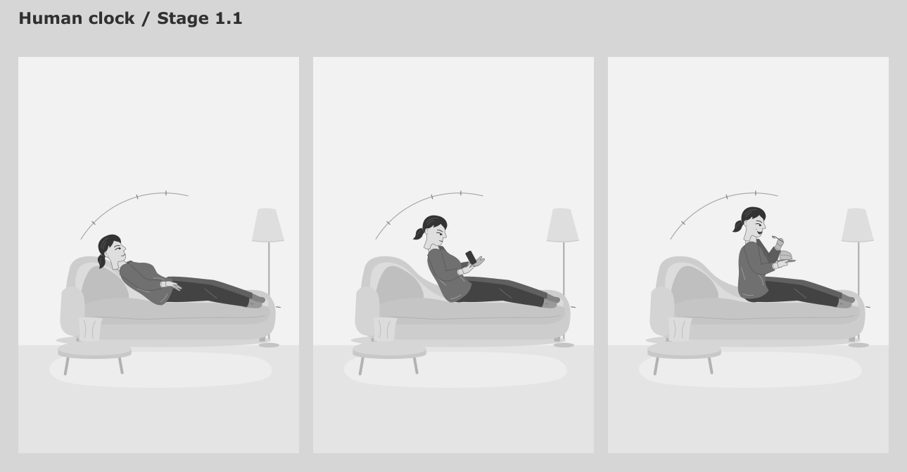

# Stage 1.1｜人体时钟艺术复审

2026-11-16，Asia/Shanghai。执行 [Issue #2](https://github.com/3387029830-dot/shunfeng/issues/2)。工作分支 `stage1/human-clock-stage11`，准备分支原头 `4b4e8b562478eb251d0adb025ebc539d0b9ce541`，冻结 Stage 1 比较基线 `3defbec20df88b3d1151dbb793e810010756a2dd`。本轮固定提交 SHA 在 GitHub Draft PR 正文和最终交接给出，避免报告自引用。



## 复审结论

**技术验证通过。B／L1／H0／S0 作为艺术复审候选。零辅助 A 的单张识别为 NO-GO。外部盲测未执行。**

B 的淡弧和对齐刻度能帮助把人体联想成时钟。P3 的头背和双腿分离最清楚，P2 的斜向也能接上钟心。P1 半躺时从头到肩的转向较大，人体轮廓和沙发靠背都向腰胯下沉，第一眼依然可能只读到“躺在沙发上”。即使有辅助，也不能认定陌生读者能先读出人体时钟。三张都保留同一机位、大形和灰阶，只作粗轮廓复审。

## 结构与方案取舍

| 实验 | 实测或目视观察 | 选择 |
|---|---|---|
| 旧腿轴／L0／L1 | 旧近远膝转折 41°／43°，外轮廓中段明显下折。L0 为 4°／4°，轴清楚但伸腿过于直硬。L1 为 12°／13°，大腿与小腿用连续曲线过渡，袜尖沿同一方向叠合 | 选 L1。髋→近袜尖 7.984°、髋→远袜尖 5.031°，三张同位置。远髋平移 (8,−10) 用户单位 |
| 上下肢长度 | P1/P2/P3 腰胯至冠点约 200／196／211，近袜尖约 245。P2 同形浅灰袜对比深袜，可减弱裤线的视觉延伸，几何长短依旧倒置 | 用抬身顺序表达动态“分针”。保留正常段长。 [明度对照](../../previews/stage11/reach_comparison.png) |
| 女性身份 | 重做头颈、肩胸、腰胯曲线、长袖、宽松裤、手和袜。脸型、耳位、刘海和服装形状共享。H1 中短发的发尾在 P2/P3 向后突出，侧轮廓更容易形成第三方向 | 选 H0，保留低扎发。小图仍须注意 P1 的马尾和靠背叠合 |
| S0／S1 家具 | S0 软垫斜面托 P1 肩背，三张腰胯坐在同一座垫压陷，脚跟留在座面深度内。S1 延长后仍能承托，但底座更大，右端空量增多，压陷边缘在 P2/P3 更显眼 | 选 S0。骨架版的接触点与竖向载荷箭头为二维观察标注，未做力学模拟 |
| 图形 A／B／C | A 保留最干净的生活动作，单张缺少时钟线索。B 用半径 245、−148° 至 −76° 的开弧，左端停在 P1 靠背上方。P2/P3 冠点实际朝 −105.640°／−88.589°，分别对齐 −106°／−89°。C 去弧后更克制，脚侧刻度半径 287，已移至袜尖与家具外，缩小时仍容易读成装饰 | B 优先盲测，C 备选。靠背、冠点与袜尖细节见 [放大对照](../../previews/stage11/clock_detail.png) |

画幅 700×990，腰胯 (364,585)。P1/P2/P3 躯干轴 −151°／−123°／−94°，冠点有效方向 −135.831°／−105.640°／−88.589°。近腿 L1 两段 2°、14°，远腿 1°、14°。上臂/前臂 64/58、大腿/小腿 112/100。具体关节、投影方向与接触坐标见 [坐标表](../../source/stage11/generated/pose_coordinates.json)。

## 人物、叙事与场景观察

- **P1 心动。** 肩背沿软垫下降，手搭在大腿前侧，视线略向上，嘴角抬起。放松与期待具备，单看灰阶面部还无法认出具体在想蛋糕。此次保留表情和视线，想象气泡留作单独叙事选择，以免在 P1 附近增加独立的大形。
- **P2 下单。** 同角色抬起躯干，双肘收在胸腹前，前后手围绕灰色手机占位。低头、目光和收紧的手腕区别于 P1，屏幕无界面。小图近手两指可能读成托举，手指接触点仍需艺术复核。
- **P3 享用。** 继续起身，近手平托小盘，远手把餐具送向嘴边。微笑张口、视线朝餐具和甜品，单张能读成准备尝一口。缩小时嘴部弧与餐具都会变弱，也可能只读成“开心地端盘”。远臂略高，会和躯干争夺方向。保留此项供剪影与小图复核。
- **参考转译。** 暖奶油客厅转成浅墙、圆润软包、低几、单盏灯与一块披毯。家具轮廓放在较浅灰阶，低几退出腰胯与腿线。食物参考只转译眼神、手腕托持与将入口时的表情，所有形状独立绘制。米白、奶油白、暖灰只记录为未来色彩意向。

制作侧在 Inkscape 导出的原始尺寸及缩放板上自评。身份一致和动作递进较上一轮清楚，人体连贯性改善属于目视观察。建议评审先看不带姿态标签的三联，再随机看小图，记录第一眼读钟、家具或坐卧的比例；随后检查 P1 的期待和 P3 的食欲、远臂。请评审决定 B 是否足以建立第一视觉，以及人物、沙发和叙事是否还需一轮 Stage 1 修订。**陌生观众盲测 NOT TESTED，独立艺术复审 PENDING。**

## 重建与验证

从仓库根目录运行 Python 3.9+。渲染使用已安装的 Inkscape 1.4.4，可通过 `SF_INKSCAPE` 指向其可执行文件。

```sh
python3 scripts/stage11/build.py --structure --out work/stage11-structure
python3 scripts/stage11/build.py
python3 scripts/stage11/verify.py
```

单独迭代 P2 使用 `python3 scripts/stage11/build.py --pose P2`。审查板和坐标表需在确认修改后完整重建。Inkscape 原生 SVG 中可在图层面板开关 `setting`、`figure`、`clock`，再用节点工具局部编辑。手工路径保存在 `source/stage11/refined/character.svg`，共享家具保存在 `source/stage11/shared/room.svg`。未在生成文件上另做系统外修形。使用 Inkscape 节点工具另存修订时，保留在 `refined/`，生成器仅写生成目录或显式工作目录。本轮无 Affinity 原生稿、印刷 PDF 或跨应用回导验收。

- **PASS。** 23 份 SVG + 1 份坐标表可字节一致重建。独立图统一画幅、固定锚点，人物与场景都有稳定 ID。SVG 使用可编辑矢量节点和本地剪切引用。三张的腿、脸型、衣服源和场景一致。
- **PASS。** 临时将 P2 躯干增加 4°，仅四份 P2 SVG 改变；P1/P3 与其余文件哈希及时间戳一致。改共享墙面和靠垫，两项都更新到三张，三张人物组字节一致。
- **PASS。** Inkscape 查询人物边界并对 20 份审查 PNG 各做两次导出，结果逐份 SHA256 一致。历史 Stage 1 目录对固定基线无 diff。新旧 P2 SVG 数值 diff、命令、退出码和所有产物哈希见 [VALIDATION.json](VALIDATION.json)。
- **NOT TESTED。** 陌生观众盲测、印刷与原生应用互操作。舒适度、真实受力与情绪是艺术判断，仍待审核。

完整交付见 [MANIFEST.md](MANIFEST.md)。**Stage 1.1 已提交艺术复审；Stage 2 未授权。**
