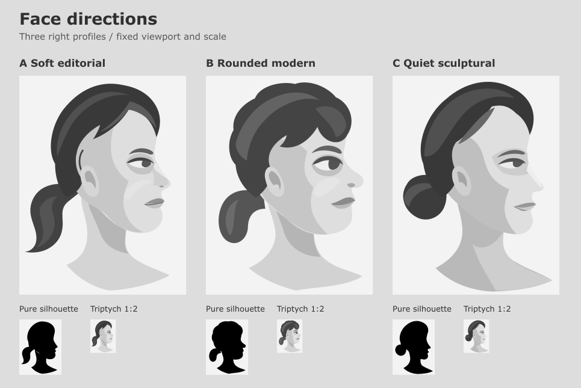

# Stage 1.1｜角色面部探索板

对应 [PR #3 脸部返工意见](https://github.com/3387029830-dot/shunfeng/pull/3#issuecomment-6914704745)。审查基线 `2e0cf0fc37a89d8b41506a92aa1209aa860a93ee`。本轮制作独立面部试验，等艺术选型。旧整合稿的脸部仍为 **ART NO-GO**。



| 交付 | PNG | 可编辑 SVG |
|---|---|---|
| A/B/C，统一右侧视角、灰阶、纯黑剪影与小图 | [设计板](../../../previews/stage11/face_study/face_directions.png) | [可编辑设计板](../../../source/stage11/face_study/generated/face_directions.svg) |
| A 方向三种表情，近景与实际观看尺寸估计 | [表情板](../../../previews/stage11/face_study/expressions.png) | [可编辑表情板](../../../source/stage11/face_study/generated/expressions.svg) |
| P2 眼球朝向屏幕、P3 嘴—食物间距 | [检查图](../../../previews/stage11/face_study/gaze_bite.png) | [可编辑检查图](../../../source/stage11/face_study/generated/gaze_bite.svg) |

## 三个方向

- **A，柔和编辑插画。** 侧面略长，鼻梁、鼻尖、人中和唇沿由短弧过渡，颏部收回。眼睑包住眼白和虹膜，颞侧压暗、颧面提亮；低扎发分出分缝、刘海、鬓角和束发。制作侧暂选 A 承担三张表情研究，较细的眉眼在小图上仍待独立复核。
- **B，圆润的现代扁平插画。** 加宽颊面、抬起下颌底边，钝化鼻尖，眼眶开口更大，发线用松软波形。小图轮廓和亲和力清楚，眼眶比例也让年龄显年轻，保留作备选。
- **C，靠轮廓和明暗面塑形。** 收束后发，减少线条，用面颊和颈侧两组灰面突出侧脸起伏。剪影最紧凑，明暗分界更硬，人物气质也更冷静。

三版在同裁切、同侧面角度和同显示倍率下并排。小图按上一版半幅预览的头高估计，画板缩放系数 0.26，约 38 px 冠顶至下巴。整体人物在原三联的观看效果仍需在批准后验证。

## A 方向表情

- **P1 放松。** 以耳部为旋转基准上仰 8°，眼睑收低，颧面明度轻，唇部闭合并微抬嘴角。颅形、耳位、颈根和发式与 P2/P3 同源。
- **P2 专注。** 下俯 8°，眉尾随眼角下倾，瞳孔在眼白内偏下朝屏幕。绘图辅助射线在屏幕中心横坐标处落在屏幕灰面内部，距标点约 0.73 个局部 SVG 单位。该值用于检查图形布局。
- **P3 愉悦尝食。** 下俯 2°，颊面在下眼睑下方上提，眉眼较舒展。上下唇留窄开口，下颌少量下转，叉尖食物向开口接近。口内标点到食物中心约 15 个局部 SVG 单位，画的是入口前一刻。缩小后嘴形变化比动作线索弱，愉悦感仍需目视评审。

## 参考使用记录

- Conconi 版画用于观察鼻梁到嘴唇、颏部的连续转折。在本板转译为较短的鼻尖曲线与清楚的上下唇关系。 [美国国家美术馆馆藏原图](https://www.nga.gov/artworks/210161-portrait-young-woman-profile)
- Aleliūnas 的肖像系列用少量大色面区分脸、发与眼眶，本板借其减法，用灰面表达人脸层次。Behance 作品通过公开作品图可见；指定 Dribbble 页可读标题和说明，原作图未成功载入，视觉对照使用同作者另一个可读作品图。 [指定 Dribbble 页](https://dribbble.com/shots/23983452-Flat-portrait) · [Behance 系列](https://www.behance.net/gallery/194987635/Flat-portrait-illustration) · [公开对照作品](https://dribbble.com/shots/23999789-Simple-portrait)
- Gagnol 指定页面可见的配图表达食物相关情绪，所查看的图未提供可直接对照的叉尖入口姿态。P3 的嘴、食物和叉尖关系在本地原创试验。 [Alimentation émotionnelle](https://www.cindygagnol.fr/alimentation-emotionnelle)
- Colbert 的角色表方法用于把共享比例与表情变化放在同板检查。本轮固定耳位、头型和发式，分别绘制眼睑、眉形、颊面与唇形。 [Character Design Sheet](https://heather-colbert.com/character-design-sheet/)

参考图未提交、未嵌入。原创矢量源为 [方向](../../../source/stage11/face_study/refined/directions.svg) 和 [表情与道具](../../../source/stage11/face_study/refined/acting.svg)，角度及目标点见 [配置](../../../config/stage11/face_study/study.json)。

## 验证与停止点

```sh
python3 scripts/stage11/face_study/verify.py
```

三份全矢量 SVG 的 ID 唯一，三张 PNG 的 Inkscape 双次导出哈希相同。全部旧阶段文件与审查基线一致。详情见 [实测与 SHA256](VALIDATION.json)。艺术选型与读感待审，面部未接回三联。PR 保留 Draft，Stage 2 未授权。
