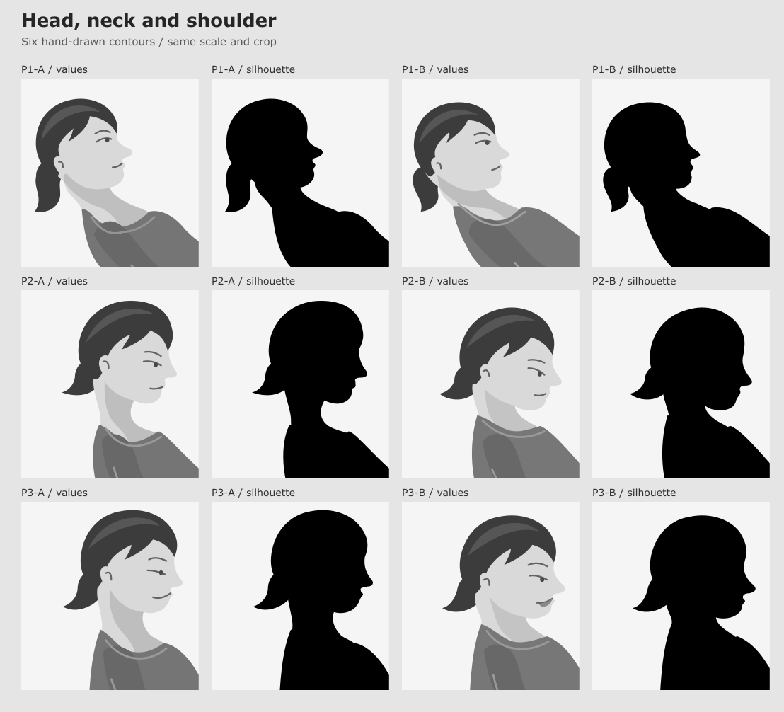

# Stage 1.1 返工｜头颈肩选型

依据 [PR #3 艺术返工意见](https://github.com/3387029830-dot/shunfeng/pull/3#issuecomment-6914114147)，在原审查提交 `070679473ad245ef53f1cb305604d1683190bbf0` 之后新增独立局部试验。**等用户和 ChatGPT 选型，Stage 1.1 艺术状态仍为 NO-GO。**



| 审查内容 | Inkscape PNG | 可编辑 SVG |
|---|---|---|
| 六个候选的同尺度局部放大与纯黑剪影 | [放大对照](../../../previews/stage11/head_neck_shoulder_study/head_neck_shoulder_study.png) | [对照板](../../../source/stage11/head_neck_shoulder_study/generated/head_neck_shoulder_study.svg) |
| 耳、下巴、颈根、肩峰与衣领接触 | [标点图](../../../previews/stage11/head_neck_shoulder_study/landmarks.png) | [标点板](../../../source/stage11/head_neck_shoulder_study/generated/landmarks.svg) |
| 缩至 1:2 的上半身，灰阶与纯黑相邻 | [小图](../../../previews/stage11/head_neck_shoulder_study/upper_body_small.png) | [小图板](../../../source/stage11/head_neck_shoulder_study/generated/upper_body_small.svg) |

## 本次重画

旧方案的头部路径向下带颈，另有一段单独的颈管，领口与肩使用第三套旋转。六个试样分别手绘带姿态补偿的连续皮肤路径，从面部和下颌到颈前、领口接触，再沿后颈回到耳后。衣领与肩袖重新配合这条曲线，脸部改用无硬描边的灰阶块面。A、B 共用刘海方向、低扎发、耳形与侧脸比例，保留成年女性的同一身份。每个候选围绕相同的局部肩锚点创作，生成板记录原三姿态肩点对应的平移；这是一套逐姿态的原创局部轮廓，尚未接入三联生成器。

| 姿态 | A · 舒展 | B · 紧凑 |
|---|---|---|
| P1 半躺 | 下颌抬起、领口更开，耳后至肩有较长斜线 | 头略收、领口略高，颈前与肩背叠合更集中 |
| P2 抬身 | 颈前由下颌转向领口，有较明显的下颌留白 | 下巴前收、眼线下倾，缩短颌下负形，收拢后颈 |
| P3 坐直 | 肩线舒展，微笑较轻，颈前留空较大 | 肩颈交接更饱满、衣领更高，嘴角微开 |

制作侧建议优先比较 **B 系列**。P2-B 和 P3-B 在纯黑小图中减少了 A 的细长负形。P1-A 较松弛，后颈实际靠垫接触仍需回到共享场景确认。小图的表情差异有限。P2 手机操作、P3 餐具互动、完整胸廓腰臀与坐姿承托均留待局部获批后统一重画和验收；外部盲测为 NOT TESTED。

## 验证与文件

可编辑输入为 [contours.svg](../../../source/stage11/head_neck_shoulder_study/refined/contours.svg)，配置与标点见 [study.json](../../../config/stage11/head_neck_shoulder_study/study.json)。机器检查覆盖六候选、唯一 SVG ID、四个实形路径组成的纯黑剪影、三份 SVG 重建及 Inkscape PNG 重导。命令、退出码、版本和 SHA256 见 [VALIDATION.json](VALIDATION.json)。

```sh
python3 scripts/stage11/head_neck_shoulder_study/verify.py
```

旧三联、独立预览、配置、源文件以及旧验证证据与原审查提交一致。本轮只交局部艺术选型，等待评审明确 A/B 或逐姿态意见，Draft 继续保留。Stage 2 未授权。
