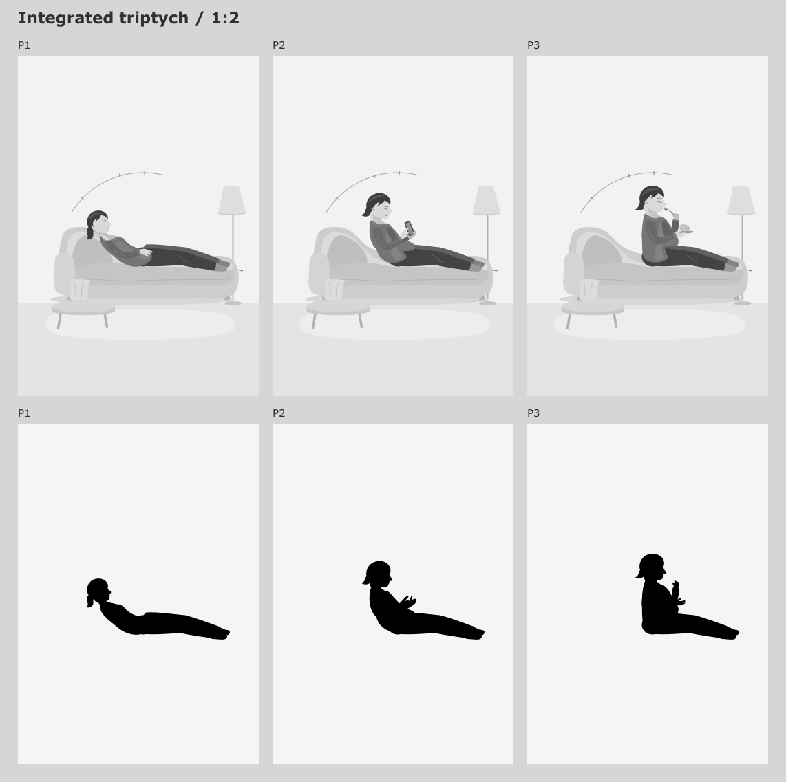

# Stage 1.1｜头颈肩选型整合验证

依据 [PR #3 最新艺术复审意见](https://github.com/3387029830-dot/shunfeng/pull/3#issuecomment-6914457468)，把 P1-A、P2-B、P3-B 接入同一套 S0 客厅。局部选型基线为 `2b9e6b2ef93441c3bdcc9ac2a7ba930628672c37`，原三联为 `070679473ad245ef53f1cb305604d1683190bbf0`。本轮供艺术复审，状态仍为 **ART NO-GO**。



## 交付

| 姿态 | 全景 PNG / SVG | 同裁切头颈肩 PNG / SVG | 纯黑剪影 PNG / SVG |
|---|---|---|---|
| P1-A 半躺 | [PNG](../../../previews/stage11/integration_study/P1.png) · [SVG](../../../source/stage11/integration_study/generated/P1.svg) | [PNG](../../../previews/stage11/integration_study/P1_detail.png) · [SVG](../../../source/stage11/integration_study/generated/P1_detail.svg) | [PNG](../../../previews/stage11/integration_study/P1_silhouette.png) · [SVG](../../../source/stage11/integration_study/generated/P1_silhouette.svg) |
| P2-B 下单 | [PNG](../../../previews/stage11/integration_study/P2.png) · [SVG](../../../source/stage11/integration_study/generated/P2.svg) | [PNG](../../../previews/stage11/integration_study/P2_detail.png) · [SVG](../../../source/stage11/integration_study/generated/P2_detail.svg) | [PNG](../../../previews/stage11/integration_study/P2_silhouette.png) · [SVG](../../../source/stage11/integration_study/generated/P2_silhouette.svg) |
| P3-B 尝食 | [PNG](../../../previews/stage11/integration_study/P3.png) · [SVG](../../../source/stage11/integration_study/generated/P3.svg) | [PNG](../../../previews/stage11/integration_study/P3_detail.png) · [SVG](../../../source/stage11/integration_study/generated/P3_detail.svg) | [PNG](../../../previews/stage11/integration_study/P3_silhouette.png) · [SVG](../../../source/stage11/integration_study/generated/P3_silhouette.svg) |

全景与净剪影均为 700×990，使用共同机位、钟心 (364,585) 和原 L1 腿轴。剪影版去掉室内、道具、钟面和五官；[1:2 并排板 SVG](../../../source/stage11/integration_study/generated/triptych_half.svg) 保留原画幅，无扩大或裁切补偿。放大图使用同一个肩锚相对窗口与 2× 缩放。

## 制作侧观察

- **P1 承托。** 将 P1-A 后枕向靠垫收低 9 个 SVG 单位并后移 2 个单位，偏移在颈根逐步归零，领口锚点保持。头发位于靠垫轮廓前，背侧衣身落在靠垫斜面。改动后颈背与靠垫间的可见间隙收小。二维叠压能交代支撑，后枕受力与靠垫体积感仍由艺术复审。 [放大标点](../../../previews/stage11/integration_study/p1_support.png) · [靠垫适配源](../../../source/stage11/integration_study/refined/p1_support.svg)
- **P2 操作。** 沿用审核选择的 B 下颌与颈根。远手包住手机底角，近手食指伸到屏幕面，袖口斜度跟随手腕；空白灰面作为屏幕占位。大图能看出点按，缩小时主要读成低头持手机。 [手部与视线标点](../../../previews/stage11/integration_study/gestures.png)
- **P3 尝食。** 移除原嘴部灰块，用窄开口和短唇线表示微张嘴。餐叉带一小块占位食物朝嘴边，另一手从下方托盘。小图能看出餐具上举，两只手与盘叠合较紧，实际食欲和表情是否自然仍待复审。 [嘴、餐具与盘标点](../../../previews/stage11/integration_study/gestures.png)
- **整体。** 胸廓、腰胯过渡、袖体和手部按每个姿态重画。纯黑剪影仍能看出腿轴稳定、上半身抬起。P1 容易先读成斜躺，P3 举腕在小图中仍可能成为额外方向。保留原 B 开弧供同比，人体时钟的第一眼识别和陌生观众盲测仍未验收。

## 验证与停止点

```sh
python3 scripts/stage11/integration_study/verify.py
```

Inkscape 实导 12 张 PNG，重复输出哈希一致。12 份 SVG 可重复生成、无嵌入位图、ID 唯一。三张原件的 S0、L1 腿轴、腰胯和 B 钟面节点与旧版一致。局部选型及原三联文件均保留。可编辑的 [新衣身和手势源](../../../source/stage11/integration_study/refined/upper_body.svg)、[混合选型配置](../../../config/stage11/integration_study/selection.json) 和 [退出码与 SHA256](VALIDATION.json) 供复查。

整合稿提交 PR #3 下一轮艺术复审。保留 Draft，不合并，不进入 Stage 2。
