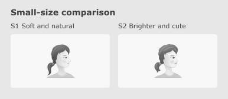

# Stage 1.1｜甜美轻萌侧脸风格板

2026-11-17。对应 [PR #3 最新返工意见](https://github.com/3387029830-dot/shunfeng/pull/3#issuecomment-6939746535)。原面部探索基线为 `427637ccb8fa3c7ca00e14ea5f6a3e60222aef0d`。本轮选型聚焦同一成年女性的亲和力，适配原暖奶油居家方向。两张原创新草图直接绘制独立 Bézier 曲线，保持灰阶与相同右侧角度。

## 参考观察与转译

| 实际看的画面 | 在画面中看到的做法 | 本轮取用 |
|---|---|---|
| **Yoojin Ahn · To a Lost Friend**，雨中抬手和等待公交的分镜 | 近景眉眼与小幅张嘴交代即时反应，远景只用姿态和少量形状延续情绪。轻浅肌肤和暗发的对比足够建立亲切感 | S1 让眼睑内侧收低，闭唇笑意留在嘴角。S2 把开口和眼神一起提亮，脸颊明暗仍轻。 [采访及实看分镜](https://www.itsnicethat.com/articles/yoojin-ahn-illustration-220321) |
| **Makoon · Sunset Dinner on Seaside Terrace** | 暖亮桌面和暗处把人物安排进共同的照明空间。远处人脸细节少，手势和相邻道具仍能交代聚餐 | 用有限的灰阶反差安排暗发、浅脸与浅领口。后续若获准，将人物与客厅共同调值，保持人体时钟为第一视觉。 [作品](https://www.illustrationx.com/artists/Makoon/170457) |
| **Alxndra Cook · Two Women Sharing Coffee & Reading** | 侧脸的睫缘、短鼻唇线和温柔刘海压得很轻，眼睛俯向杯子，两人姿势和动作让小表情成立 | S1 的杏眼位置接近侧面轮廓，眼白和虹膜在上下眼睑内。两张都以细线加暗部，而让腮部保持亮面。 [作品图](https://media.illustrationx.com/images/artist/AlxndraCook/168177/webp/500/two-women-sharing-coffee-reading.webp) |
| **Leah Han · 屋顶浴缸插画** | 角色松开的眼睑、轻嘴角和舒展姿势传达独处的自在。头发、浴缸上沿和小装饰的线条有疏密，脸上笔画少 | S1 和 S2 用少量散发线表现刘海与后束的方向，面部暗线集中在眼睑与开口。 [实看作品](https://media.illustrationx.com/images/artist/LeahHan/171024/webp/500/whimsical-cityscape-bath-scene.webp) · [访谈](https://www.creativeboom.com/inspiration/how-leah-hans-illustrations-celebrate-modern-femininity/) |

Cook 的指定作品列表出现浏览器校验，使用了同画廊的公开作品图。Han 的指定访谈可读，内嵌作品图在当前环境未载入，使用同作者公开作品图。外部图仅作观察，仓库内交付的是原创草图。

## 请求选型

| 候选 | 视觉差别 | 可编辑源 |
|---|---|---|
| [S1 轻甜自然](../../../previews/stage11/style_study/S1.png) | 杏眼偏窄，柔和细眉，闭唇微笑；发冠弧面更安静，束发沿后颈下落。制作侧观察，成人感和松弛更明显。 | [SVG](../../../source/stage11/style_study/S1.svg) |
| [S2 更萌一点](../../../previews/stage11/style_study/S2.png) | 上睑弧度更圆，眼神更亮，脸颊饱满，小幅开唇；刘海更蓬，后束更短，减少外侧延伸。制作侧观察，小图亲和力更明显，幼龄边界仍需用户判断。 | [SVG](../../../source/stage11/style_study/S2.svg) |

两张近景共用 520×556 画幅。小图同裁切、同缩放，冠顶至下巴约 39 px。Inkscape 实际导出两张 660×706 近景和一张 386×168 小图。三份 SVG 无栅格嵌入，仅有本地矢量渐变引用，旧证据与基线一致。 [小图 SVG](../../../source/stage11/style_study/small_comparison.svg)

本轮停在风格确认。P1/P2/P3 三表情与全身整合待选型后再议。旧脸部维持 ART NO-GO，PR 保留 Draft，Stage 2 未授权。
