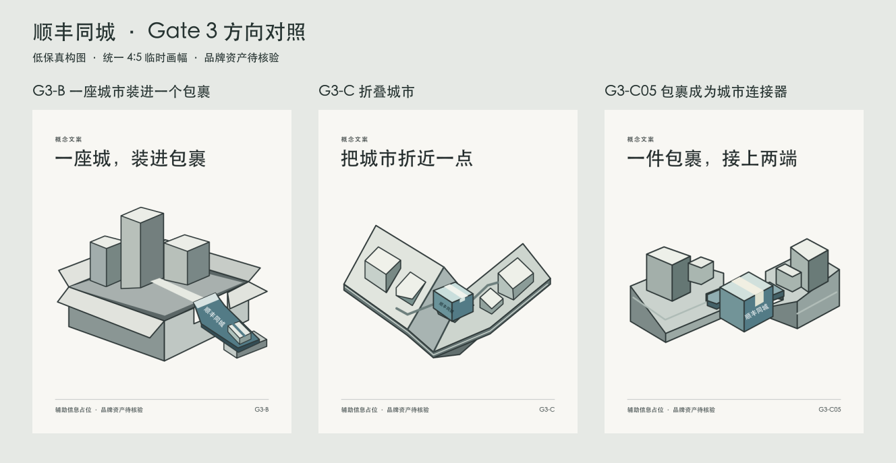

# Gate 3｜顺丰同城低保真方向板

对应 [Issue #9](https://github.com/3387029830-dot/shunfeng/issues/9) 和 [Gate 3 正式任务书](../../docs/design/GATE3_CONCEPT_BOARDS.md)。交付为三张选型板，待 ChatGPT 与用户艺术复审。工作分支 `design/single-poster-reset`，同步基线 `7951d938c402fe90524e33f0cff24521157fc944`。交付提交的完整 SHA 记在 [Draft PR #8](https://github.com/3387029830-dot/shunfeng/pull/8)。



| 方向 | 可编辑 SVG | 原尺寸预览 | 六项检查 |
|---|---|---|---|
| G3-B 一座城市装进一个包裹 | [SVG](../../source/stage3/g3-b.svg) | [PNG](../../previews/stage3/g3-b.png) | [检查图](../../previews/stage3/g3-b-checks.png) |
| G3-C 折叠城市 | [SVG](../../source/stage3/g3-c.svg) | [PNG](../../previews/stage3/g3-c.png) | [检查图](../../previews/stage3/g3-c-checks.png) |
| G3-C05 包裹成为城市连接器 | [SVG](../../source/stage3/g3-c05.svg) | [PNG](../../previews/stage3/g3-c05.png) | [检查图](../../previews/stage3/g3-c05-checks.png) |

三张画布统一为 640 × 800 px，临时竖幅 4:5。并排预览将三板都缩至 384 × 480 px。以同一字号、位置和字重放置主标题与辅助信息。标题上方标注「概念文案」，主体内放普通可编辑品牌文字「顺丰同城」，辅助位标注「品牌资产待核验」。暖白、深灰和低饱和蓝灰是比较用的临时色，蓝灰专用于交付构件，三案一致。文字为本机预览用 PingFang SC / Heiti SC / sans-serif 回退链，未锁印刷尺寸、字体或最终配色。

## 主体与物件关系

```mermaid
flowchart LR
    subgraph B[G3-B｜箱体容纳城市]
        b1[箱底街面与三个街块] --> b2[箱壁降口和承载坡] --> b3[箱外落点]
    end
    subgraph C[G3-C｜整张纸形成谷折]
        c1[纸面左街块] --> c2[折点的交付包裹] <-- c3[纸面右街块]
    end
    subgraph C05[G3-C05｜包裹扣住街块]
        d1[左街块卡槽] <--> d2[带两端卡舌的封箱包裹] <--> d3[右街块卡槽]
    end
```

各检查图下排展示去字与移除交付构件的原构图，可对照承载坡、折点包裹和双卡舌所做的事。

### G3-B｜一座城市装进一个包裹

- **核心创意。** 一只打开的包裹容纳一段城市，箱底街面延伸穿出箱壁，交付在外侧门槛落地。
- **阅读顺序。** 第一眼是展开箱翼和突出箱口的高低楼体。第二眼顺浅色街面走到箱壁开口，沿蓝灰承载坡抵达外侧小包裹。三个街块共用同一箱底，画面只留一条通出去的路。
- **品牌融入。** 「顺丰同城」沿出箱承载坡排印，读字方向与交付方向一致。去掉坡和小包裹后，原箱内街面在箱壁处截止，独立的外侧门槛无法接通。坡面为原创示意，箱体、封装方式和品牌授权待核验。
- **视觉语言。** 可用原创纸板微缩实拍或有限平面层次的矢量。保持屋顶剪影和箱翼错落，并留出坡口负形。箱体开口、城市脚下的街面和坡体连接处是关键。
- **优势及风险。** 尺度反差清楚、留白稳定。缩略时小包裹偏像坡端卡块，藏去标题仍会有微缩模型或地产联想。折减后翼和拉开楼高使纯黑轮廓中能同时见到箱翼与高低屋顶。执行难度中高，侧坡的结构、箱外落点和真实空间尺度需要再验。

### G3-C｜折叠城市

- **核心创意。** 一张连续的城市纸面弯成一个谷折，两片街缘收向折点的一件交付包裹。
- **阅读顺序。** 第一眼是 V 形纸雕和一道内折，第二眼从两侧低浮雕及街缘来到谷底包裹。薄切边表达两片街面属于同一张纸。
- **品牌融入。** 品牌文字落在折点包裹的可见侧面，两侧街缘在它附近结束。拿走包裹仍看得到折叠，但折点失去配送信息。折点卡位与封签只是形态符号，官方封签和包装待核验。
- **视觉语言。** 候选为无印花厚纸压折、纸模实拍或克制矢量。应维持一条明确谷折和连续纸边。更高的写实度会增加把折面误作建筑场景的风险。
- **优势及风险。** 折叠的外轮廓独立，纸艺潜力较强。纯黑只认出 V 形，灰阶及删字时有打开的书或纸雕摆件联想，包裹读成“抵达”的把握低于 B 和 C05。执行难度高。与所见 FedEx 版本的构图区别有证据，但空间压缩主题仍相邻，外部近似检索有限。按高风险留作审查，需先解决无标题时的配送可读性并扩展近似核查。 [绘制前近似检索](SIMILARITY.md)

### G3-C05｜包裹成为城市连接器

- **核心创意。** 一件有封箱带的包裹同时卡入两个相隔的街块，让两端形成一段连续结构。
- **阅读顺序。** 第一眼是夹在两块城市之间的封箱件，第二眼看见左右卡舌进入相应的槽口。两侧屋顶不等高，也无接触，避免误读为城市基底原已相连。
- **品牌融入。** 品牌文字印在承力的包裹侧面，封箱带与纸箱体积提供物流语义。移除包裹组以后，两块底座间的白色间隙完全露出。卡舌和封箱带均为概念结构，官方用料、包装和品牌规范待核验。
- **视觉语言。** 候选为低色数矢量或两块纸板街区与一件封箱物的搭景摄影。可让卡槽继续使用明确的纸材边缘，维持盒体和卡舌的可辨性。
- **优势及风险。** 去标题与去品牌仍能看到两端由一件盒物相接，拆件对照最清楚。纯黑会吞掉卡舌，缩略仍有拼装玩具或科技连接的误读。执行难度中等，纸箱特征与街区属性要平衡，不能只强化机械感。

## 技术验证

- Inkscape 1.4.4，构建 `dcaf3e7`。在仓库根目录运行 `python3 scripts/render_stage3.py`。脚本检查三件独立 SVG 的 XML、尺寸、唯一 ID、真实路径和可编辑文字，并用 `inkscape --query-all` 查询主体、标题、品牌及交付构件。源文件均无嵌入位图或外部依赖。
- Inkscape 导出了 3 张原尺寸 PNG、18 张检查瓦片和 4 张合成审查图。检查瓦片保留在对应检查图里。灰阶用同一亮度公式重映射 SVG 色值。纯黑将主体填色及描边转黑。128 × 160 px 瓦片直接从 SVG 导出，按原像素尺寸嵌入。去标题版本移除了画外标题和辅助层，保留主体内品牌文字。去品牌及拆件版本再分别移除品牌文字或交付构件组。 [输出尺寸、大小和 SHA-256](RENDER_RESULTS.json)
- 连续运行两次导出并以 `cmp` 对照 JSON，7 张交付 PNG 和 18 张临时检查瓦片的 SHA-256 均一致。逐一核对 7 张交付 PNG 的哈希与体积，检查了 65 处本地链接。暂存补丁检查通过，仓库扫描在本轮 21 个变更文件中未发现问题。全仓扫描仍报告 Gate 1 原有 Business Wire 链接中的 `/news/home/`，已核实是 URL 路径误报。
- 从仓库根目录用 Codex CLI 0.156.1 的 App Server `skills/list` 核对五套 repo Skill，均为 `enabled: true`。使用同一 App Server 的 `thread/start` 创建一次只读临时会话，`turn/start` 按顺序提交五条 `SkillUserInput`，返回 `completed` 和五条逐项检查。初次调用因本机默认模型与账户不兼容失败，依据 `model/list` 选择账户提供的模型后重试通过。绘制与审查中分别应用项目总控的停点、design-principles 的去字辨识和视觉层级、creative-direction 的不同机制与统一尺度比较、art-direction 的实际作品核对、collateral-design 的幅面与阅读距离检查。
- 正式印刷、Affinity 原生排版、实物校样及用户盲测均未执行。本轮以分层 SVG 为源，无 Affinity 原生文件。

## 品牌待核验与交接

官方介绍可支持「第三方即时配送服务」与泛同城多场景业务。画面仅使用品牌文字和自创的非官方包装结构。官方 Logo 版本和授权、VI/标准色、字体、包装、运单、封签、配送装备及适用公开文案均待核验。画面未使用官方口号、时效数字、价格或覆盖和服务承诺。 [顺丰同城品牌介绍](https://www.sf-intra-city.com/about/) · [仓库品牌资产说明](../../assets/brand/README.md) · [授权台账](../../assets/licenses.md)

艺术判断与建议顺序见[三方向比较矩阵](COMPARISON.md)。本轮交付后等待 ChatGPT 与用户复审，尚无最终方向决定或 Gate 4 申请。
