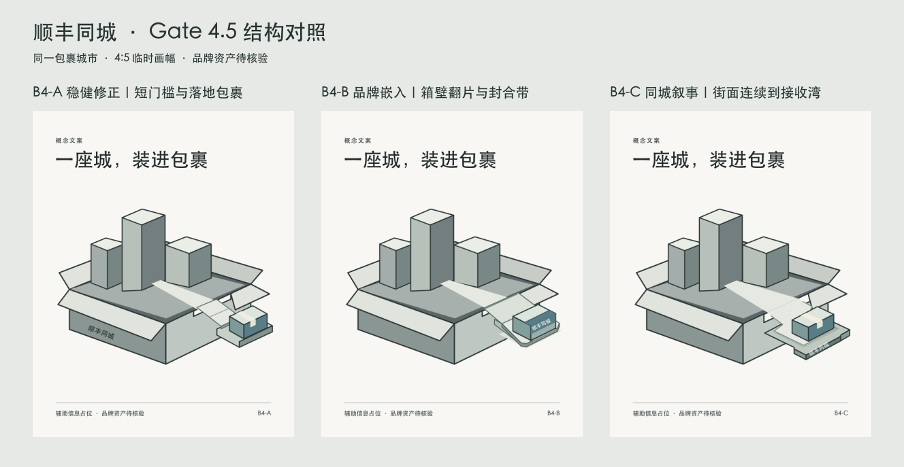

# Gate 4.5｜G3-B 三个结构深化版本

按 [Issue #10](https://github.com/3387029830-dot/shunfeng/issues/10) 与 [Gate 4.5 任务书](../../docs/design/GATE4_5_B_REFINEMENT.md) 执行。工作分支 `design/single-poster-reset`，执行前核对远端及 Draft PR #8 均为 `ae275efb7a1df36a48d9dce05f82802e746dfa2d`。源板继承自 Gate 3 提交 `7715a21cd939801314443f3733b8e0bcb0f2972e` 的 [G3-B SVG](../../source/stage3/g3-b.svg) 和[原版检查图](../../previews/stage3/g3-b-checks.png)。交付 SHA 记录在 [Draft PR #8](https://github.com/3387029830-dot/shunfeng/pull/8) 与 Issue #10。

| 版本 | 分层可编辑 SVG | 构图预览 | 六项诊断 |
|---|---|---|---|
| B4-A 稳健修正 | [SVG](../../source/stage4_5/b4-a.svg) | [预览](../../previews/stage4_5/b4-a.png) | [检查表](../../previews/stage4_5/b4-a-checks.png) |
| B4-B 品牌嵌入 | [SVG](../../source/stage4_5/b4-b.svg) | [预览](../../previews/stage4_5/b4-b.png) | [检查表](../../previews/stage4_5/b4-b-checks.png) |
| B4-C 同城叙事 | [SVG](../../source/stage4_5/b4-c.svg) | [预览](../../previews/stage4_5/b4-c.png) | [检查表](../../previews/stage4_5/b4-c-checks.png) |

三份源均从 G3-B 副本编辑。保留后箱翼、三个街块的位置和高度、同一标题与辅助层级，针对开口、纸板、接收面、封箱件和品牌承载改动。统一 640 × 800 px 的 4:5 临时画布，三版在并排图中均为 384 × 480 px。比较沿用低饱和蓝灰的诊断色关系、相近细节量和原概念文案，印刷规格及正式文案仍待定。G3-C05 冻结为备选，G3-C 冻结。

## 逐版结构说明

### B4-A｜短门槛与独立落地包裹

- **原问题和变化。** 保留箱体与三个街块，以和箱底近似齐平的短门槛跨过箱壁开口，接到独立落台。外侧包裹从贴在坡上的小件变为有顶盖、封口带和两块完整侧面的箱子，平放在落台上，接触边界可见。
- **阅读路径。** 先看见箱翼内的城市。第二眼沿浅街面越过开口与短门槛，在独立小箱停住。灰阶及 128 px 读图时，小箱比原坡端卡块更像完整封箱件。门槛通过单道接缝和板厚区别于落台，短而无机械细节，仍可能被看成模型连接板。
- **品牌理由。** 「顺丰同城」贴合主箱承重侧壁的斜边，身份回到打开的运输容器。它避开街面和箱外交付终点。强项是主次清楚，弱项是品牌仍可能像普通纸箱印字，箱壁开口与独立落台具有微缩展台观感。
- **制作风险。** 需要真实可解释的门槛与落台接触关系。若放大模型质感，三栋楼与独立底座仍可能像楼盘模型。A 保留为最接近原稿的比较基准。

### B4-B｜箱壁翻片与跨边封合带

- **原问题和变化。** 将箱壁的打开部分做成一片通到地面的纸板。用铰线、折边与裁角交代翻片的来源，箱外省去独立厚底座。封箱件有完整顶面和侧面，落在翻片的外半段。
- **阅读路径。** 第一眼仍是箱中城市，第二眼沿纸板折痕到外侧蓝灰封箱件。去题后有可读的开箱、翻片、落箱关系，铰线在缩略时会损失。纸板形状削弱传送带联想，同时可能被误读成箱盖或包装开箱广告。
- **品牌理由。** 字样排在跨顶盖边、延续至外箱侧面的原创封合带上。带面随着包装而折，功能属于封箱包裹，字不落在路上。去品牌图仍保留同一封合带，能直观看到它先有包装结构功能。
- **制作风险。** 小尺寸里封口带仍可作色块，但中文字和纸边会先掉。折角、纸板落点和封合带宽度需在独立艺术复审中判断。包装带、字样均为概念示意，官方封签及印法待核验。

### B4-C｜街面连续到箱外接收湾

- **原问题和变化。** 放宽箱壁开口，箱内街面用同一明度平面直接穿过箱壁，再在箱外转折、展开到一个有错台边缘的接收区。保持三个原街块，靠街面的走向、边缘与终点解释同城交付。
- **阅读路径。** 第一眼仍是大箱里的城市。第二眼能从街块之间找出一段连续街面，在末端看到有封口带的独立包裹。移除构件后街面在箱口处中断，接收区空置。去题时连续性最清楚。缩略仍有“伸出一块城市模型底板”的联想，末端放大过度会强化台座感。
- **品牌理由。** 「顺丰同城」位于接收区朝外的竖向挡边，标明交付发生的地点。街面负责通行视觉，品牌附着在终点结构上。挡边与包装形制属于原创示意，官方可用识别及使用方案待核验。
- **制作风险。** 接收区比 A 宽，可能在印刷中分散主视觉。需要保持接收面浅、街面连贯、包裹接触明确。挡边字小，暂时依赖较大的查看尺度。

## 比较矩阵

以下为制作者桌面看图判断，未经消费者测试。先看 128 × 160 原尺寸，再用灰阶及隐藏图层复核。纯黑只检验整体轮廓和外缘，无法保留封口带及大多数接触面。

| 验收点 | B4-A | B4-B | B4-C |
|---|---|---|---|
| 第一眼及纯黑 | 高低屋顶与箱翼保留；外箱与独立台在底缘合并 | 城市箱体仍主导；纸板折边和小箱并为外侧凸起 | 箱体仍主导；外侧接收区较宽，内外细节在剪影消失 |
| 灰阶与 128 × 160 缩略 | 独立小箱与落台可分，斜接缝偏弱；小箱能依靠顶盖与侧面读出 | 灰阶可见封合带跨边，缩略能见封箱件但不宜读字；裁角和翻片边变弱 | 跨箱面及弯向终点的浅面仍连续；缩略保留外侧小箱，接收区立边细节减弱 |
| 去标题 | 门槛和独立落点仍可读，关系稳定但稍显模型感 | 翻片与封箱件仍可读，纸板可能被当作普通箱盖 | 从街块跨到箱外的读法最连贯，仍有沙盘联想 |
| 仅去品牌 | 箱壁保持完整，送达靠独立落台支撑 | 保留跨边封合带，包装结构仍成立 | 保留竖向终点挡边，街面到箱外的因果仍成立 |
| 拆掉连接与交付包裹 | 箱口后露出空落台，短门槛和落地小箱一起消失 | 翻片和封箱件一起消失，原落地点只留接触影 | 街面在箱口处结束，接收区空置，原来的一次抵达断开 |
| 主要过读风险 | 微缩展示或独立模型台 | 包装品牌广告、普通开箱 | 城市沙盘底座、接收区抢主体 |
| 复审优先级 | 3，作为低改动对照 | 2，重点审品牌随包装结构成立 | 1，重点审无标题时的同城因果 |

**建议复审顺序 B4-C → B4-B → B4-A。** C 的街面与终点在去标题时相连最清楚，B 给出本轮结构性最强的品牌承载，A 验证少量改动能把原坡端零件修正为落地封箱件。三版保留各自的误读风险，仍待独立艺术复审和用户决定。

## 技术记录

| 项目 | 实际操作与结果 |
|---|---|
| 基线与冻结检查 | 以 `git archive` 提取旧渲染脚本和三份 Gate 3 SVG 到临时目录，运行 `python3 scripts/render_stage3.py`。用 `cmp` 核对输出与旧清单一致。对 `source/stage3`、`previews/stage3`、`reports/stage3` 和旧脚本作 Git 差异检查，结果为空。 |
| 五套项目 Skill | 从仓库根目录用 Codex App Server `skills/list` 发现 5 套 `repo`、`enabled: true` 的 Skill，加载错误为 0；随后按项目 Skill、`design-principles`、`creative-direction`、`art-direction`、`collateral-design` 顺序以五条 `SkillUserInput` 原生只读调用，重连后状态为 `completed`。应用到本轮的边界、无字层级、结构变量、承托可信度、同尺寸审查。 |
| 新增重建脚本 | 在仓库根目录运行 `python3 scripts/render_stage4_5.py`。输入为三份 SVG，复用 Gate 3 的 Inkscape 渲染、纯黑、灰阶及拼板函数。使用 1.4.4（`dcaf3e7`）。XML 与 `--query-all` 核对画布、可编辑品牌文字、唯一 ID、城市、箱体、街面、包裹与诊断组。源不含嵌入位图或外链。 |
| 诊断方法 | 去标题同时隐藏标题与画外辅助层，主体内品牌保留。只去品牌隐藏其文字组，保留封带、侧壁或挡边。拆件单独移除出箱连接及送达包裹组，保留原接收面或接触影作对照。缩略图为直接导出的 128 × 160 px，检查表内按原像素放置。 |
| 两次构建 | 连续运行渲染脚本两次，以 `cmp` 比较 JSON。3 张正常构图、18 张诊断和 4 张拼板共 25 个 PNG 的尺寸、字节数与 SHA-256 一致。另逐个核对跟踪 PNG 的哈希。[完整渲染记录](RENDER_RESULTS.json) |
| 仓库检查 | 暂存差异检查通过。仓库既有扫描脚本对本轮变更无问题。Gate 1 文件中的 Business Wire `/news/home/` 仍被全仓规则误报为本机路径，核对后确认为历史 URL。 |
| 艺术与印刷范围 | 实际看图仅为桌面自审。官方 Logo、VI、包装、封签、标准色和印刷字体待核验。所有品牌字样为可编辑文字占位，未加入官方口号、时效或服务承诺。Affinity 最终工程及实体印刷校样未执行。 |

**Gate 4.5 已完成，等待 ChatGPT 与用户评审；Gate 5 未启动。**
