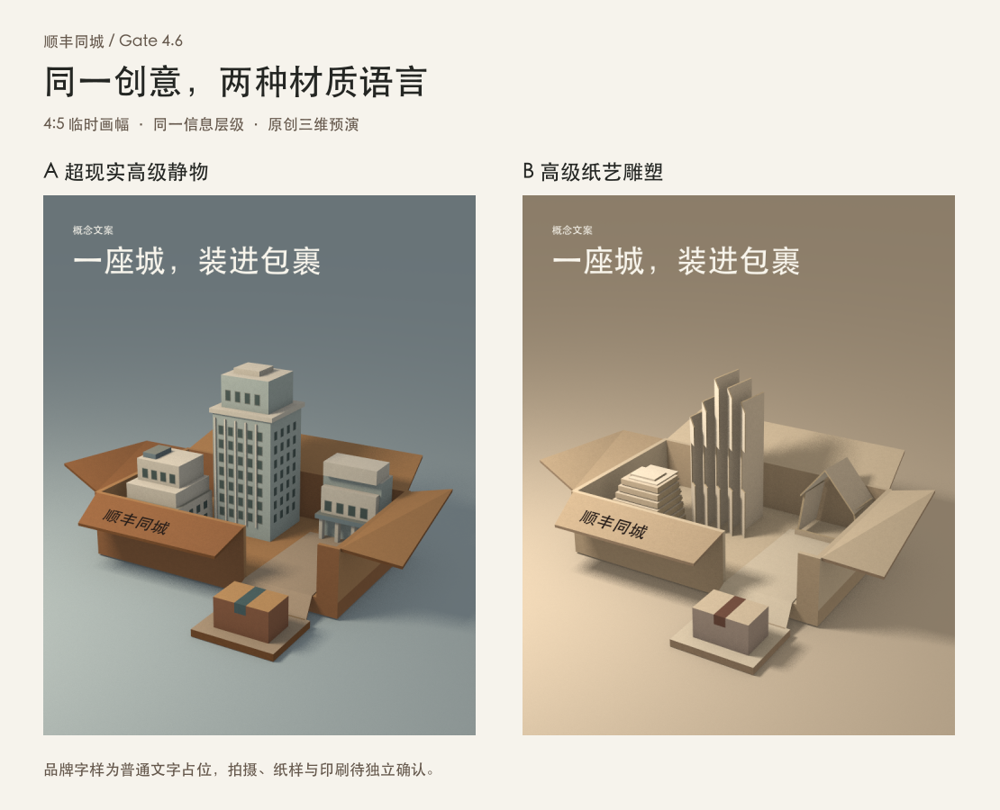

# Gate 4.6｜同一创意的两种视觉语言

[Issue #11](https://github.com/3387029830-dot/shunfeng/issues/11) · [任务书](../../docs/design/GATE4_6_STYLE_EXPLORATION.md) · [Draft PR #8](https://github.com/3387029830-dot/shunfeng/pull/8)

| 路线 | 艺术指导板 | 主视觉预演 | 原创细节裁切 | 查阅与来源 |
|---|---|---|---|---|
| A 超现实高级静物 | [风格板](../../previews/stage4_6/style-a-board.png) | [主图](../../previews/stage4_6/style-a-frame.png) | [纸箱、微缩建筑、接触阴影](../../previews/stage4_6/style-a-detail.png) | [四个案例、执行与权利边界](STYLE_A_SURREAL_STILL_LIFE.md) |
| B 高级纸艺雕塑 | [风格板](../../previews/stage4_6/style-b-board.png) | [主图](../../previews/stage4_6/style-b-frame.png) | [纸层、切口与折边](../../previews/stage4_6/style-b-detail.png) | [四个案例、执行与权利边界](STYLE_B_PAPER_SCULPTURE.md) |

交付分支 `design/single-poster-reset`，本轮同步起点 `4714a85d82457f8d1305fc9838b9270df4c04e0b`，推送前保留远端补充提交 `86e6c4449548054493476e166ea2e23547751bf9`，结构基线 `2f5efd76761b09226f5b5b3e3809b34f7815db2f`。本轮交付 SHA 记录于 PR #8 与 Issue #11 的交接。C｜现代艺术指导平面海报保留为备选，未制作。 [只隐藏品牌文字的证据](../../previews/stage4_6/no-brand-comparison.png) · [五套 Skill 调用凭证和应用矩阵](SKILL_APPLICATION.md)

## 共同比较条件

重看 G3-B 与 B4-A/B/C 的 SVG 和 Gate 4.5 对照。原稿证明了内外连接，但有滑梯、落件像零件和地产模型的风险。共用骨架选取 **G3-B 的打开纸箱、B4-C 的连续浅街面与 B4-A 的独立落地包裹**。简化成侧壁宽开口、短纸面过渡与薄接收足。这个骨架用于隔离 A/B 的材质差异，保留在实验层。

两张主视觉均为 720 × 900 px，4:5 临时画幅。同一概念标题、品牌普通字占位、固定左上留白和主体层级。两张均为原创三维光照预演。A 的建筑体积与投影测试拟摄影质感；B 的薄板厚度、切口和叠层测试纸雕结构。两者使用不同材质反射、局部构造、相机高度和面光尺度。对箱翼字样按实际三维折面重新投影，同时保留只隐藏文字的独立对照。官方文字版式、Logo、VI、封签与包装规范留待核验。本轮没有嵌入第三方作品或资产。

## 艺术复审矩阵

以下是对本轮实际 PNG 的桌面观察；制作、服务语义和用户偏好仍需独立复审。

| 评审项 | A 超现实静物 | B 纸艺雕塑 |
|---|---|---|
| 第一眼和记忆点 | 先看到深色箱体里露出的浅色都市体量，城市语义较直接。 | 先看到张开的纸箱与竖向折片。纸雕整体轮廓集中，理解为城市晚半拍。 |
| 摆脱低保真矢量观感 | 体块有一致透视、遮挡与接触阴影，箱壁有几何厚度。微表面仍有数字预演质感。 | 改用叠纸阶面、带切口折片和中空折顶。薄边真实可见；纸材纤维和装配仍停在数字假设。 |
| 箱—城市—到达点 | 三者在一个阴影空间内，浅街面连续越过开口，外侧包裹平放。存在“建筑模型旁摆包装”的第二读法。 | 材料统一，街面像同一纸片从箱中翻出。颜色过近会吃掉内街边缘。 |
| 材质可信与可实现性 | 局部图能观察纸板、石质体积与同向投影。实拍要验证接触、边缘反光和同尺度景深。 | 局部图可见层距、薄边和实际几何开口。实物卡槽及承重未验证。 |
| 舒适度与留白 | 建筑细节集中，整体留白足够；塔楼重复窗孔需防止地产宣传式观感。 | 同色系克制，浅调联贯；材料接近时画面会显得过平。 |
| 品牌如何进入 | 文字随后重定位到主箱前翼真实折面，停靠在容器结构内。只去品牌后仍读得出运输关系，具体品牌身份不成立。 | 同位置同尺度，贴合纸材表面。只去品牌后统一的纸张机制保留；量产印刷、纸料与字样整合尚未打样。 |
| 实体印刷 | 冷灰与褐色阴影，暗区层级与深色面积需做光谱/打样核验。 | 暖灰浅色层多，临近纸色容易并阶；需检验侧光阴影与切边能否印出来。 |
| 预算、工具链、版权 | 中高。真实布景、摄影模型与合成占工时；Blender 未见本机安装，现有本地渲染只用于预演。采用原创搭景可减少对第三方素材授权的依赖。 | 中等，取决于纸样工时和返工；优先手工纸样与原创实拍。卡件、刀模和第三方纸艺资产无复用授权。两条都未估价或产生采购费用。 |
| 128 × 160、灰阶与轮廓 | 小图中高楼、箱翼和外端小箱保留，细窗、字样和门槛纹理消失。灰阶箱与建筑较易分开。纯黑时承托和小包裹合为凸起。 | 小图可见纸翼与高低剪影，浅纸阶层较早合并；灰阶要靠侧影。纯黑也只能确认轮廓连通，不能确认外端包裹识别。 |
| 残余误读 | 地产沙盘、常规模型广告、孤立的普通物流小箱。 | 层片被看成屏风、浅色纸样像儿童手工、终点薄垫像模型附件。 |

**桌面复审建议。** 先看 A 的缩略可读性，再看 B 的局部纸层和灰阶。若评审优先考虑远距离识别，A 的建筑与箱体明度差更有利；若更看重让纸张成为统一视觉材料，B 的结构更一致。实拍质量、纸样承重以及哪一种画面更符合品牌感受仍待用户和 ChatGPT 评估。

## 执行与验证

- Gate 1、Gate 1B 的历史参考只作方法基线。本轮另外实际查看了八个不同作品图像。A 的三项品牌/商业项目为 Dior、Sall Whisky 与 Hermès。B 的两项为 Canon 与 Hermès。各案授权状态、观察与不可复制特征见分路线报告。
- 五套 repo Scope Skill 在仓库根目录原生发现，App Server 接收五个 `SkillUserInput`，重连后返回 `completed`。项目 Skill 守住 G3-B 与 A/B 范围，design-principles 核对轮廓和先后读图，creative-direction 固定比较变量，art-direction 核对实际案例与材质条件，collateral-design 检查画幅、印刷及材料待验项。
- 从仓库根目录运行 `python3 scripts/render_stage4_6.py`。由本机 Apple Clang 编译原创场景，通过 CPU 光线相交、64 样本/像素面积光和环境遮蔽得到两张原始预演。通过本机 `sips` 和 Inkscape 1.4.4 导出 14 张 PNG。灰阶采用亮度权重，轮廓由三维主体遮罩得到，缩图从同一主图文件导出。以 `cmp` 比较两次构建清单，PNG 的尺寸、字节数与 SHA-256 一致。还逐个核对 14 张 PNG、本地链接、四张诊断图的中性 RGB 通道及两张轮廓的未裁切外边。 [原创建模与光照源](../../source/stage4_6/lighting.cpp) · [重建脚本](../../scripts/render_stage4_6.py) · [环境与输出哈希](RENDER_RESULTS.json)
- 检查了 Gate 3 / Gate 4.5 的旧源、预览和报告，Git 无差异。暂存差异检查与本轮文件扫描通过。全仓扫描仍命中 Gate 1 旧 Business Wire 链接的 `/news/home/`，已确认是 URL 路径误报。
- 艺术与生产仍待复审。真实棚拍、纸样切割与承托、印厂纸张、ICC、出血、印刷像素规格、正式字体及品牌资产均未验证。未建立 Affinity 最终工程。本轮技术出图通过，艺术效果不据此判通过。

**Gate 4.6 风格探索完成，等待 ChatGPT 与用户评审；Gate 5 未启动。**
